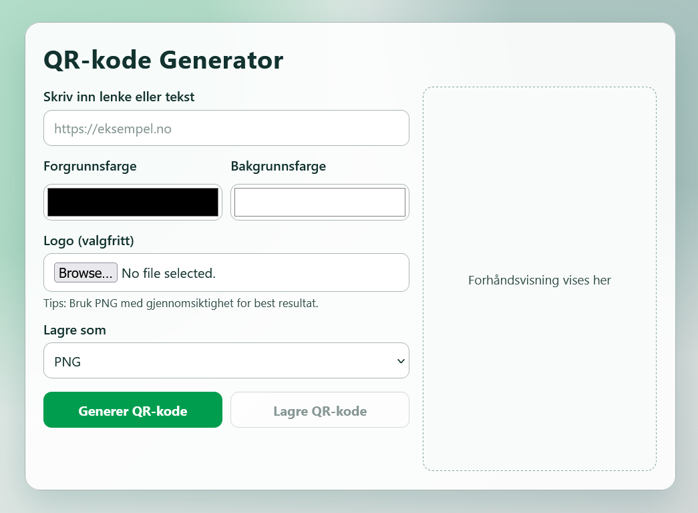
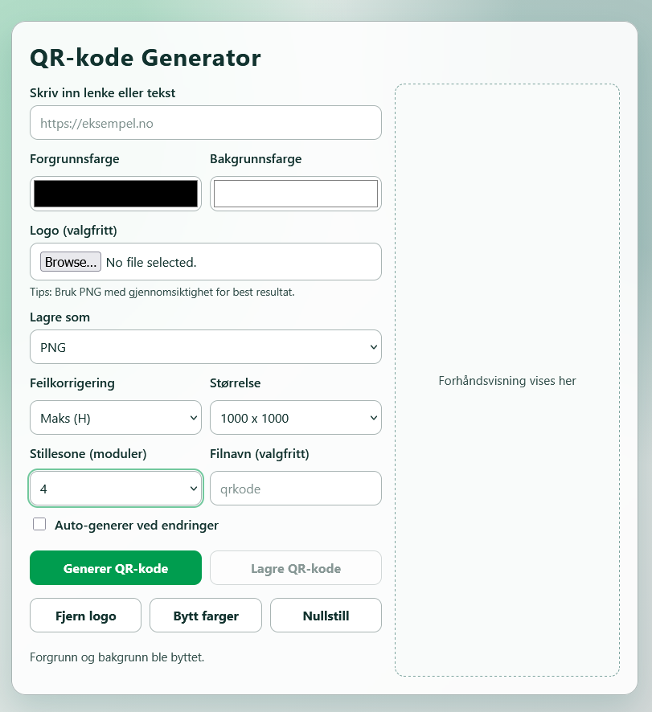
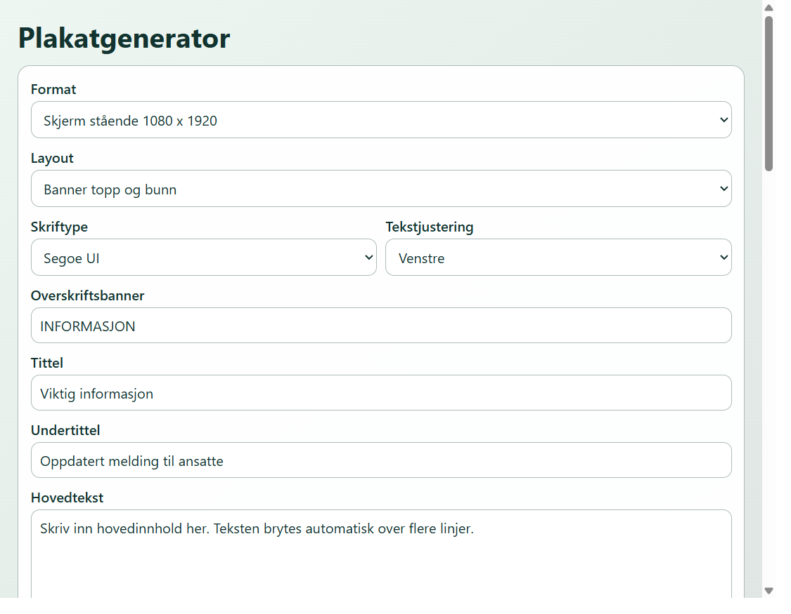
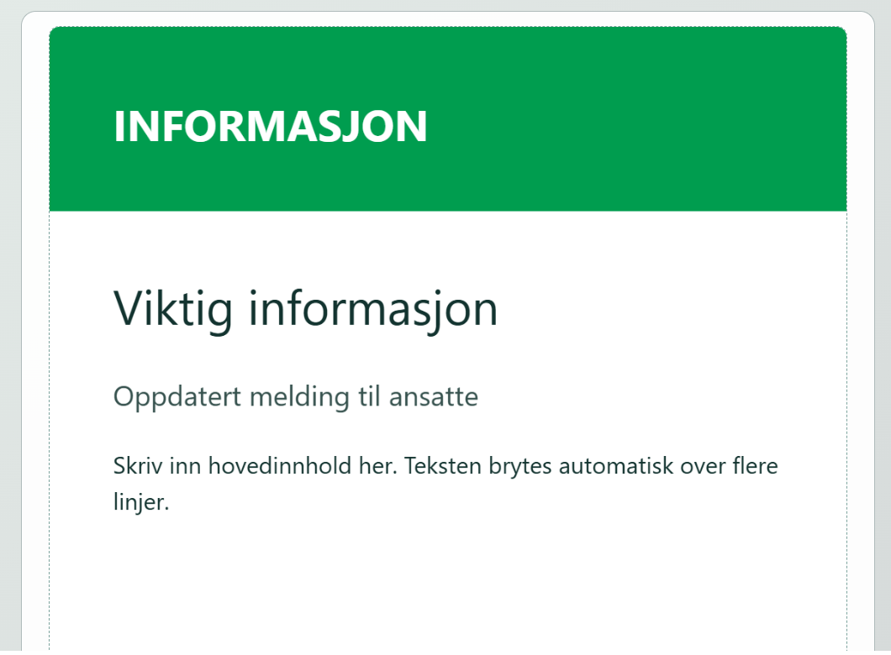
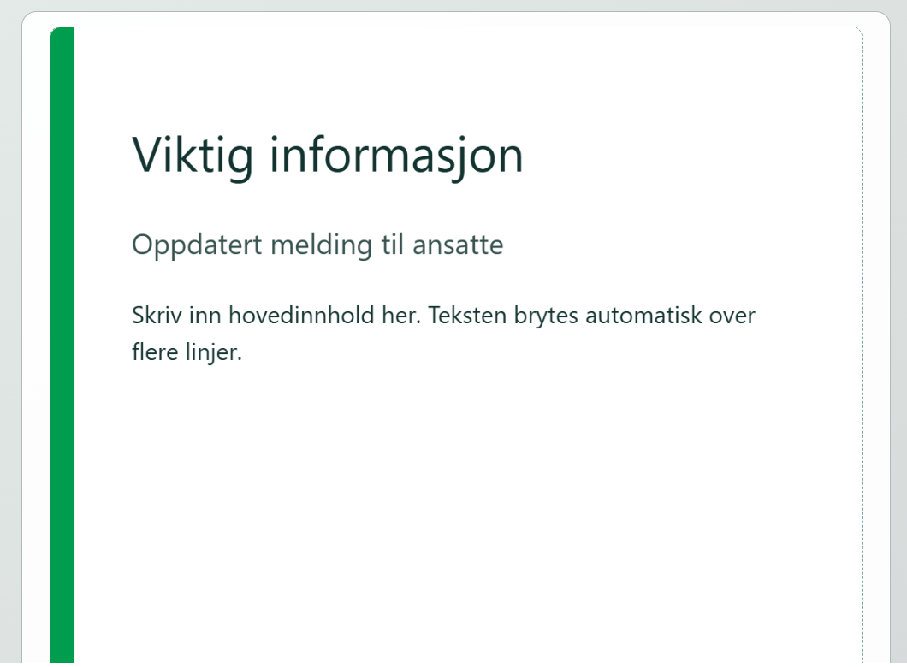
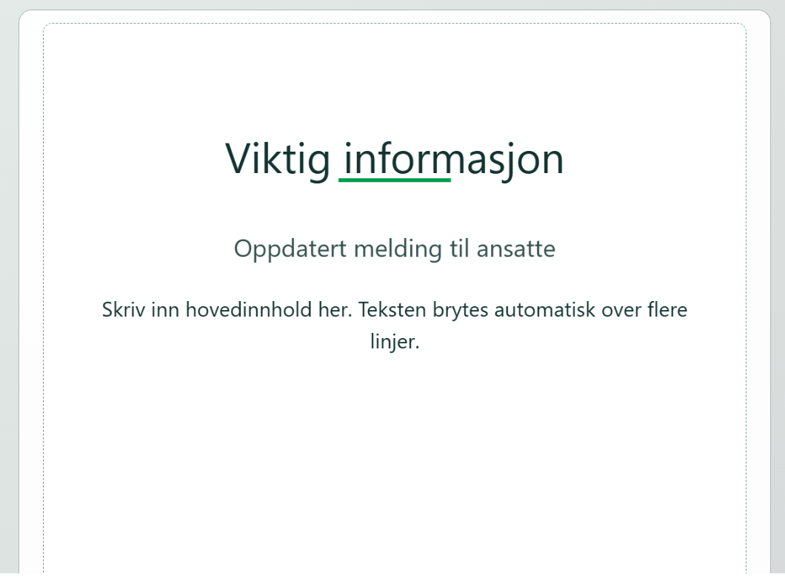
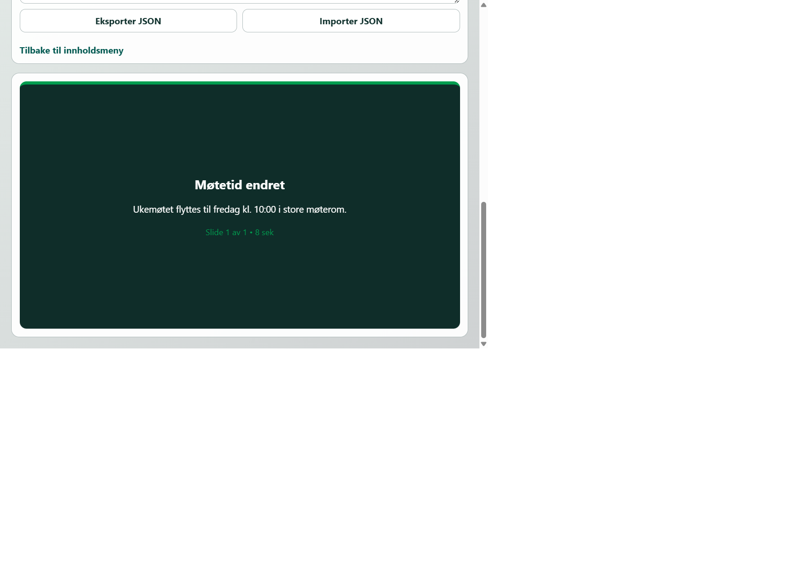
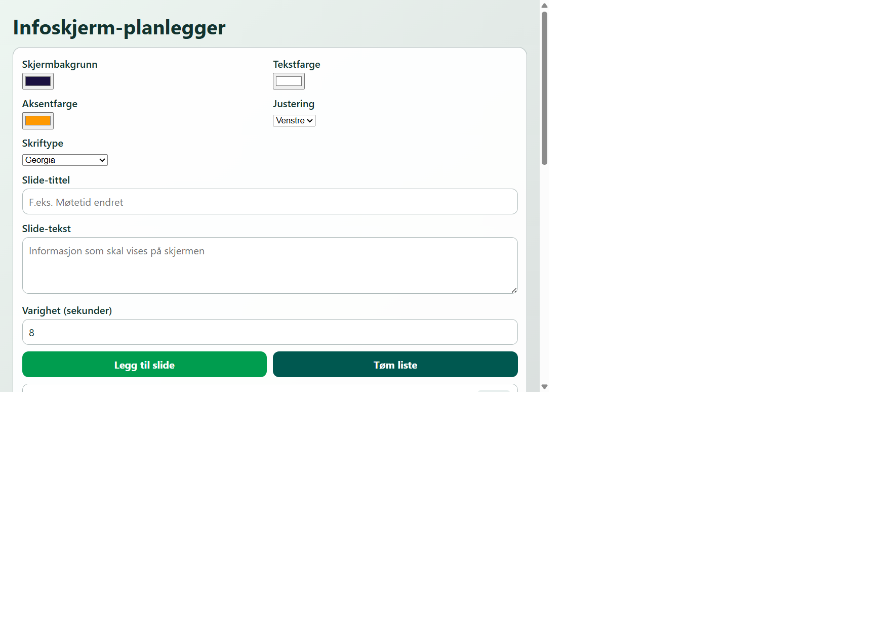

# Webmultiverktøy

En samling frittstående nettbaserte verktøy. Ingen backend, ingen bygg-steg — hvert verktøy er én HTML-fil med inline CSS og JavaScript. Bruk snarveien `Verktoy - START HER.lnk` i rotmappen, eller åpne [source/app/index.html](source/app/index.html) direkte i nettleseren, for å starte.

## Mappestruktur

```
Verktoy - START HER.lnk    Snarvei med eget ikon som åpner source/app/index.html
source/
  app/index.html           Hovedmeny med lenker til alle verktøy/kategorier
  tools/
    qr/index.html           Undermeny: velg mellom enkel og utvidet QR-generator
    qr-simple/index.html    QR-kode generator (enkel)
    qr-plus/index.html      QR-kode generator (utvidet)
    innhold/index.html      Undermeny: plakat, infoskjerm og video
    plakat/index.html       Plakatgenerator
    infoskjerm/index.html   Infoskjerm-planlegger
    video/index.html        Videomanus-kort
    fargepalett/index.html  Fargepalett-verktøy
    tekstteller/index.html  Tekst-/ord-teller
    strekkode/index.html    Strekkode-generator
```

## Verktøy

| Verktøy | Beskrivelse |
| --- | --- |
| QR-kode generator (enkel) | Generer QR-koder med farge og logo, last ned som PNG/JPG/SVG. |
| QR-kode generator (utvidet) | Som over, pluss feilkorrigeringsnivå, størrelse, margin og auto-generering. |
| Plakatgenerator | Lag plakater med tittel, tekst og kontaktfelt i flere formater, last ned som PNG. |
| Infoskjerm-planlegger | Bygg en spilleliste med slides og forhåndsvis den som en automatisk loop. |
| Videomanus-kort | Scene-for-scene manus med varighet, eksporter til tekstfil. |
| Fargepalett-verktøy | Lag nyanser og beslektede farger fra en basisfarge, sjekk WCAG-kontrast mellom to farger. |
| Tekst-/ord-teller | Tell tegn, ord, setninger og avsnitt, og få et estimat på lesetid. |
| Strekkode-generator | Lag strekkoder (CODE128, EAN, UPC, CODE39, ITF-14), last ned som PNG eller SVG. |

### QR-kode generator (enkel)

Rask generering av QR-koder fra tekst eller lenke. Du kan velge forgrunns- og bakgrunnsfarge, legge til en egen logo midt i koden, og laste den ned som PNG, JPG eller SVG.



### QR-kode generator (utvidet)

Samme utgangspunkt som den enkle versjonen, men med flere innstillinger: feilkorrigeringsnivå, størrelse og margin på koden, i tillegg til auto-generering mens du skriver og en nullstill-knapp.



### Plakatgenerator

Lager plakater/skjermbilder til print eller digitale infoskjermer. Støtter flere formater (A4/A3 og skjerm i stående/liggende), tre layout-maler (banner, sidestolpe, minimalistisk), valgfri skrifttype og tekstjustering, og egne fargevelgere for bakgrunn, aksent og tekst. Resultatet rendres på et canvas og lastes ned som PNG.







### Infoskjerm-planlegger

Bygger en spilleliste med informasjonsslides (tittel, tekst, varighet) som kan forhåndsvises i en automatisk loop – nyttig for planlegging av innhold til en infoskjerm. Skjermbakgrunn, tekstfarge, aksentfarge, skrifttype og justering kan tilpasses, og listen kan eksporteres/importeres som JSON.




### Videomanus-kort

Lager et scene-for-scene manus for en informasjonsvideo. Hver scene har tekst på skjerm, voiceover og varighet i sekunder. Manuset settes sammen til et lesbart tekstutkast som kan lastes ned som `.txt`.

### Fargepalett-verktøy

Tar utgangspunkt i én basisfarge og genererer en skala av nyanser (lysere → mørkere) samt beslektede farger (komplementær, analoge og triade). Har også en egen kontrastsjekker som regner ut WCAG-kontrastforhold mellom to farger og viser om kombinasjonen består AA/AAA-kravene.

### Tekst-/ord-teller

Live-telling mens du skriver eller limer inn tekst: tegn (med og uten mellomrom), ord, setninger, avsnitt, snitt-ordlengde og et estimat på lesetid. Statistikken kan kopieres til utklippstavlen med ett klikk.

### Strekkode-generator

Genererer strekkoder i flere formater (CODE128, EAN-13, EAN-8, UPC-A, CODE39, ITF-14) med valgfri strek-/bakgrunnsfarge, bredde, høyde og synlig verditekst. Strekkoden kan lastes ned som PNG eller SVG.

## Design

Alle sider deler samme fargepalett og stil:

- `--brand-green: #009d4f`
- `--brand-deep-green: #005850`
- `--brand-light: #cfd2d3`
- `--text: #12332f`
- `--muted: #385552`
- `--border: #afbbbb`

Hver verktøyside har en "Tilbake"-lenke til foreldrenivået (kategori eller hovedmeny).

## Eksterne avhengigheter

Lastes fra CDN kun der det trengs, ingen `npm install`:

- `qrcode-generator` (QR-verktøyene)
- `JsBarcode` (strekkode-generatoren)
